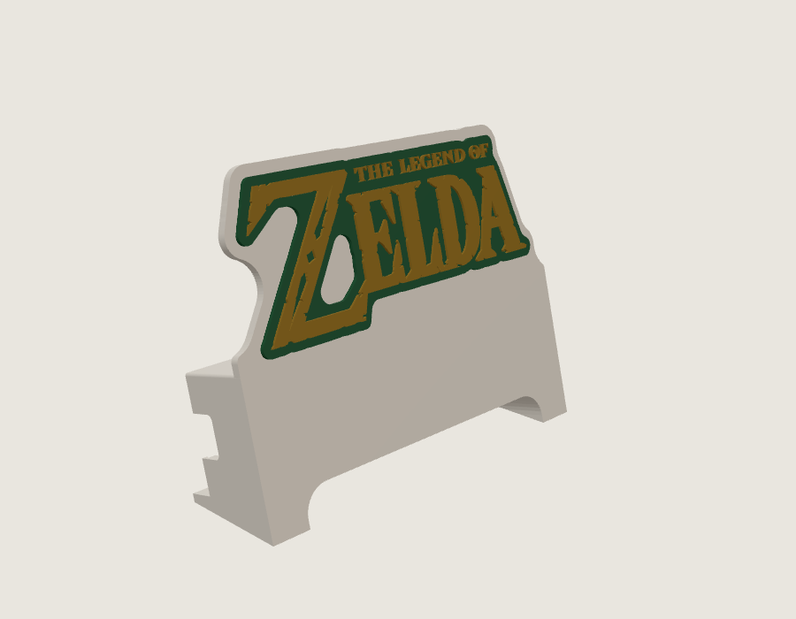
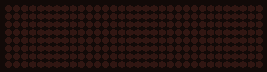
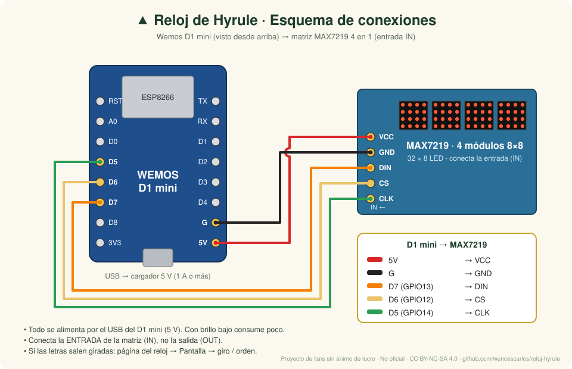
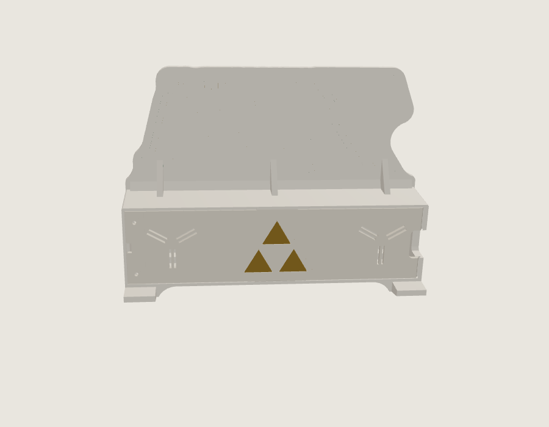
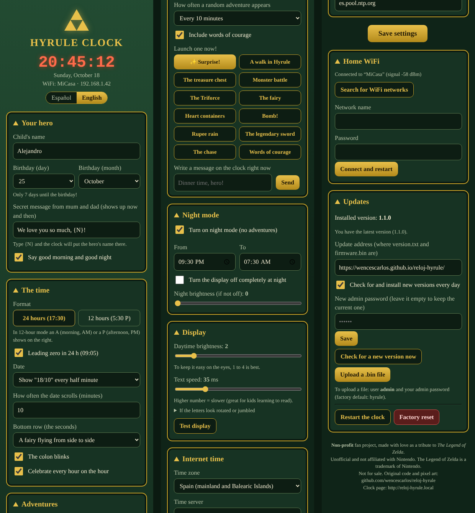

# ▲ Hyrule Clock

[Español](README.md) · **English**

**A clock with adventures for little heroes.** Made with 3D printing, a Wemos D1 mini and 4 LED matrices, as a tribute to *The Legend of Zelda*.

> ## ⚠️ NON-PROFIT fan project
> - Made at home as a gift for a child and shared **for free**.
> - **Unofficial** and not affiliated with **Nintendo**. *The Legend of Zelda* is a trademark of Nintendo.
> - **Not for sale**: neither the code, nor the models, nor clocks built with them ([CC BY-NC-SA 4.0](LICENSE) license).
> - The code, the font and the pixel art are **original**. 3D models by other authors are used **under their CC BY-NC 4.0 license, with credit**.
> - More information in the [legal notice](AVISO_LEGAL.md) (in Spanish).

<p align="center">
  <br>
  <i>Real clock animations (recorded with the included simulator)</i>
</p>

<p align="center">
  
</p>

---

## ✨ What it does

| | |
|---|---|
| 🕐 **Exact time from the internet** | With automatic daylight saving time |
| 🔤 **24 h or 12 h with AM/PM** | In 12-hour mode an **A** (morning) or a **P** (afternoon) shows up |
| 📅 **Date** | "18/10" every half minute or "SUNDAY, OCTOBER 18" now and then |
| 🧚 **The seconds fairy** | Flies along the bottom row, from side to side |
| 🗡️ **11 random adventures** | Treasure chest, monster battle, Triforce, fairy, bomb, sword... |
| 🧒 **With the child's name** | "ALEJANDRO HAS ASSEMBLED THE TRIFORCE!" |
| 🎂 **Birthday** | Countdown and a party with cake and fireworks |
| 🌙 **Good morning and good night** | Plus night mode: minimum brightness or display off |
| 📱 **Setup from your phone** | At http://reloj-hyrule.local, no app to install |
| 🌍 **English or Spanish** | Chosen on the clock's page: it changes the clock's texts and the page itself |
| 🔄 **Updates itself** | Downloads new versions from this repository |

<p align="center">
  
  
  
</p>

---

## 🧰 Materials

| Item | Quantity |
|------|----------|
| Wemos D1 mini (ESP8266) | 1 |
| MAX7219 4-in-1 LED matrix (32 × 8, 32 × 32 mm modules) | 1 |
| Dupont wires or thin wire | 5 |
| 5 V USB charger and micro-USB cable | 1 |
| PLA filament: light color for the case, green and gold for the logo and the Triforce | — |

### Wiring

<p align="center"></p>

| MAX7219 matrix | Wemos D1 mini |
|---|---|
| VCC | 5V |
| GND | G |
| CLK | D5 |
| CS | D6 |
| DIN | D7 |

---

## 🖨️ 3D printing

All parts are ready to print in [`modelos_3d/`](modelos_3d/):

| Part | File | Color | Author |
|------|------|-------|--------|
| Base with crest | `base_reloj_zelda.stl` | **Light** (white or ivory), so the display shows through | Remix of **Qrome**'s case |
| Back cover with Triforce | `tapa_trifuerza.stl` | Same as the base | Remix of **Qrome**'s case |
| Logo background | `fondo_logo.stl` | Green | Made from **geektoybox**'s logo |
| Logo letters | `logo_letras_geektoybox.stl` | Silk gold | Original by **geektoybox** (unchanged) |
| Gold Triforce | `trifuerza_dorada.stl` | Silk gold | Original from this project |

The models by other authors are published under their **CC BY-NC 4.0** license (Attribution-NonCommercial), which allows non-commercial remixes:
- *ESP8266 Wemos Clock News Weather Scrolling Marquee* case, by **Qrome**: [Printables](https://www.printables.com/model/25374-esp8266-wemos-clock-news-weather-scrolling-marquee)
- *Legend of Zelda Logo Text*, by **geektoybox**: [Printables](https://www.printables.com/model/499505-legend-of-zelda-logo-text)

If you'd rather start from the originals, [`modelos_3d/generar_modelos.py`](modelos_3d/generar_modelos.py) builds the same parts from them.

<p align="center"></p>

**Quick print notes:** PLA 1.75 mm, no supports and no multicolor printer needed. Print the base **face down** with 0.2 mm layers: the display shows through a 0.6 mm front skin (3 layers), so the base **must be a light color**. The logo is glued onto the crest using two 3.5 mm pieces of 1.75 mm filament as alignment pins. The full print and assembly guide is in [`modelos_3d/LEEME.md`](modelos_3d/LEEME.md) (in Spanish).

---

## 💾 Installing the firmware

1. Install the [Arduino IDE](https://www.arduino.cc/en/software).
2. Go to **File → Preferences → Additional boards manager URLs** and add:
   `https://arduino.esp8266.com/stable/package_esp8266com_index.json`
3. In the **Boards Manager**, install **esp8266** (version 3.1.2 or later). **No libraries needed.**
4. Open `firmware/RelojHyrule/RelojHyrule.ino` and choose:
   - **Board:** LOLIN(WEMOS) D1 R2 & mini
   - **Flash Size:** 4MB (FS:1MB OTA:~1019KB)
5. Press **Upload**.

### With Visual Studio Code and PlatformIO

1. Install [Visual Studio Code](https://code.visualstudio.com/) and the **PlatformIO IDE** extension (VS Code suggests it when you open the folder).
2. Open the repository folder. The [`platformio.ini`](platformio.ini) file is already set up: board, memory and LittleFS.
3. In the PlatformIO bottom bar: **✓** builds, **→** uploads over USB and **🔌** opens the serial monitor.
4. To upload over WiFi to a clock that is already installed, choose the **d1_mini_wifi** environment (it uses `reloj-hyrule.local` and your admin password).

**Without building:** download `firmware.bin` from the [project website](https://wencescarlos.github.io/reloj-hyrule/) and flash it with `esptool.py write_flash 0x0 firmware.bin`.

### First time

1. Connect your phone to the **Reloj-Hyrule** WiFi (password: **trifuerza**).
2. The clock's page opens (if it doesn't, go to http://192.168.4.1).
3. Tap **English** at the top of the page to switch the clock and the page to English.
4. Choose your home WiFi, type the password and press **Connect**.
5. Done: the clock is at **http://reloj-hyrule.local**. Type the child's name and birthday there.

> If the letters look rotated or jumbled, go to **Display** on the clock's page, change the rotation or the order of the modules and press **Test display**: you should see 1 2 3 4.

<p align="center"></p>

---

## 🔄 Automatic updates

Every time a change is pushed to the `firmware/` folder of this repository, **GitHub Actions** builds the firmware and publishes it on **GitHub Pages**:

- `https://wencescarlos.github.io/reloj-hyrule/version.txt`
- `https://wencescarlos.github.io/reloj-hyrule/firmware.bin`

Clocks check that address once a day. If the version is newer than theirs, **they update themselves**.

To publish a new version:
1. Change the number in `firmware/RelojHyrule/configuracion.h`, for example `#define VERSION_RELOJ "1.0.1"`.
2. Push the change to GitHub (*commit* and *push*).
3. Wait for the **"Compilar y publicar el firmware"** action to finish (*Actions* tab).

---

## 📁 Structure

```
reloj-hyrule/
├── firmware/
│   ├── RelojHyrule/        ← clock firmware (Arduino IDE)
│   └── herramientas/       ← font/sprite drawing, PC simulator and animation recording
├── modelos_3d/             ← ready-to-print STL parts + instructions
├── docs/                   ← project website (GitHub Pages)
├── imagenes/               ← screenshots and animations (en/ = in English)
├── .github/workflows/      ← automatic build and publishing
├── README.md               ← this document in Spanish
├── AVISO_LEGAL.md          ← non-profit project, trademarks and credits
└── LICENSE                 ← CC BY-NC-SA 4.0
```

The code and file names are in Spanish, as the project was born as a gift for a Spanish-speaking child.

---

## 🙏 Credits

- ***ESP8266 Wemos Clock News Weather Scrolling Marquee* case:** **Qrome (David Payne)**, [Printables](https://www.printables.com/model/25374-esp8266-wemos-clock-news-weather-scrolling-marquee), CC BY-NC 4.0 license. Remixed: the logo crest was added to the base and the Triforce to the back cover.
- ***Legend of Zelda Logo Text*:** **geektoybox**, [Printables](https://www.printables.com/model/499505-legend-of-zelda-logo-text), CC BY-NC 4.0 license. The letters are included unchanged and their outline is used for the background and the crest.
- **Firmware, font, pixel art, texts, web page, model script and gold Triforce:** original work by [wencescarlos](https://github.com/wencescarlos), made from scratch.
- ***The Legend of Zelda*:** trademark of **Nintendo**. Thanks for so many adventures. 💚

---

<p align="center"><b>Made with love, not for profit</b><br>
<sub>Unofficial project, not affiliated with Nintendo · Not for sale · CC BY-NC-SA 4.0</sub></p>
