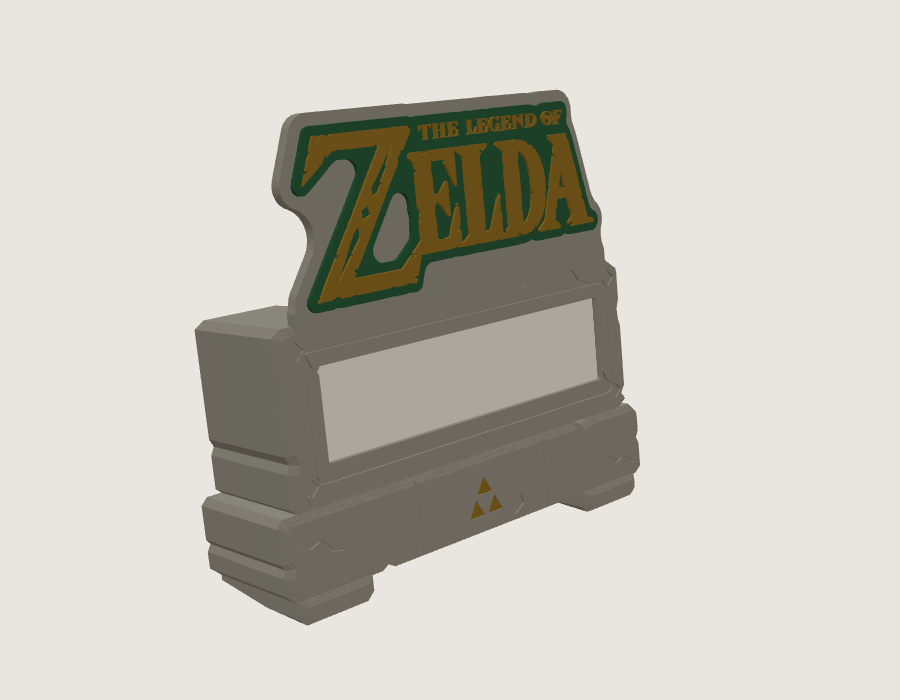
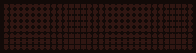
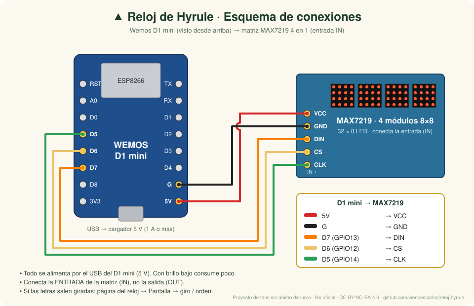
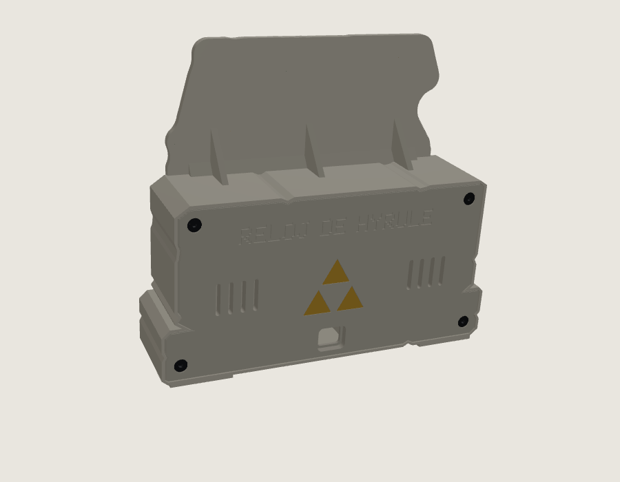
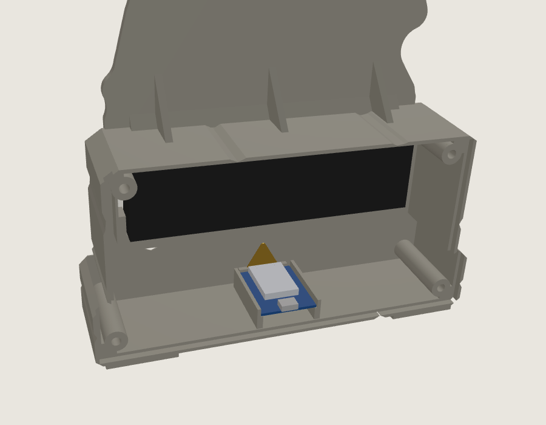
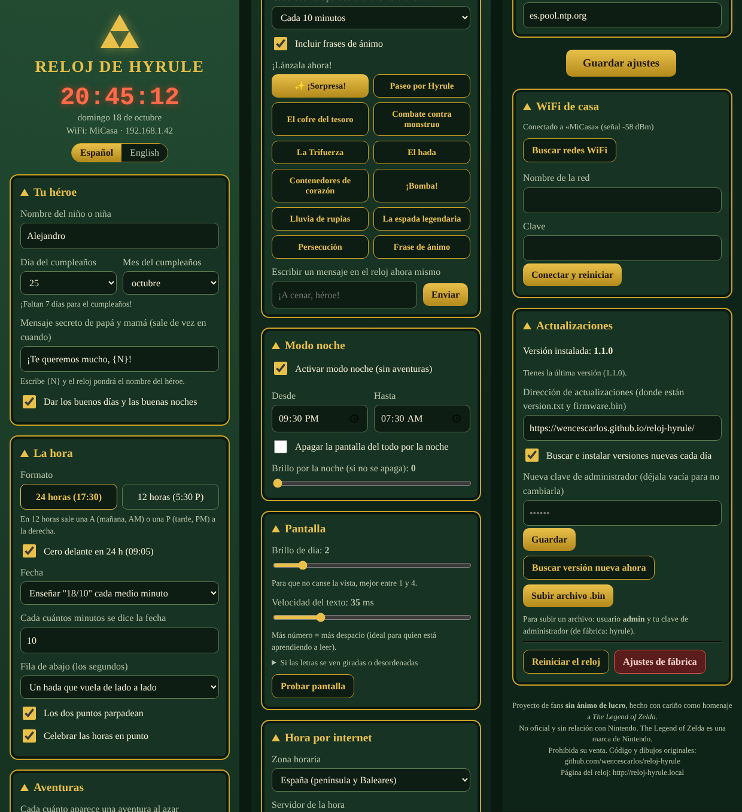
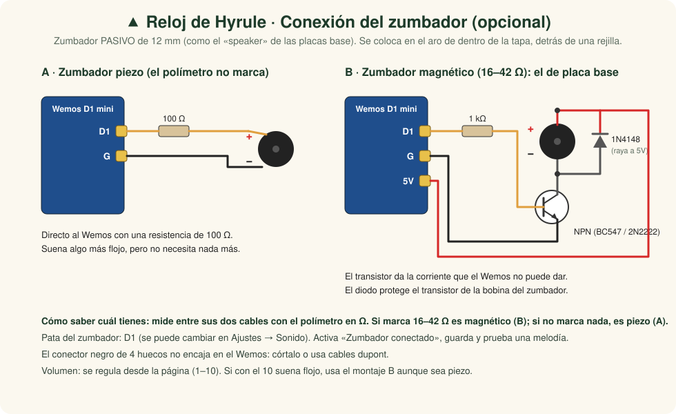
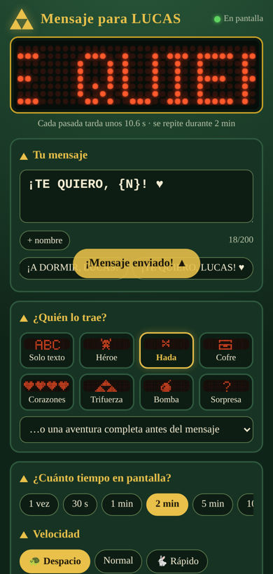

# ▲ Reloj de Hyrule

**Español** · [English](README.en.md)

[](https://github.com/wencescarlos/reloj-hyrule/releases/latest) [](https://github.com/wencescarlos/reloj-hyrule/actions/workflows/publicar-firmware.yml) [](LICENSE) 

**Un reloj con aventuras para pequeños héroes.** Hecho con impresión 3D, un Wemos D1 mini y 4 matrices LED, como homenaje a *The Legend of Zelda*.

> ## ⚠️ Proyecto de fans SIN ÁNIMO DE LUCRO
> - Hecho en casa como regalo para un niño y compartido **gratis**.
> - **No es oficial** ni tiene relación con **Nintendo**. *The Legend of Zelda* es una marca de Nintendo.
> - **Prohibido venderlo**: ni el código, ni los modelos, ni relojes hechos con él (licencia [CC BY-NC-SA 4.0](LICENSE)).
> - El código, la carcasa 3D, la fuente de letras y los dibujos en píxeles son **originales**. Las letras del logo son de geektoybox y se usan **con su licencia CC BY-NC 4.0, citándolo**.
> - Más información en el [aviso legal](AVISO_LEGAL.md).

<p align="center">
  <br>
  <i>Animaciones reales del reloj (grabadas con el simulador incluido)</i>
</p>

<p align="center">
  
</p>

---

## ✨ Qué hace

| | |
|---|---|
| 🕐 **Hora exacta por internet** | Con el cambio de hora de verano e invierno automático |
| 🔤 **24 h o 12 h con AM/PM** | En 12 h sale una **A** (mañana) o una **P** (tarde) |
| 📅 **Fecha** | "18/10" cada medio minuto o "DOMINGO 18 DE OCTUBRE" de vez en cuando |
| 🧚 **El hada de los segundos** | Vuela por la fila de abajo, de lado a lado |
| 🗡️ **11 aventuras al azar** | Cofre del tesoro, combate, Trifuerza, hada, bomba, espada... |
| 🧒 **Con el nombre del niño** | "¡LUCAS HA REUNIDO LA TRIFUERZA!" |
| 🎂 **Cumpleaños** | Cuenta atrás y fiesta con tarta y fuegos artificiales |
| 🌙 **Buenos días y buenas noches** | Y modo noche: brillo mínimo o pantalla apagada |
| 📱 **Configuración desde el móvil** | En http://reloj-hyrule.local, sin instalar ninguna app |
| 🌍 **En español o en inglés** | Se elige en la página del reloj: cambia los textos del reloj y de la página |
| 🎓 **Modo concentración** | Para estudiar: solo la hora, quieta, sin fecha ni aventuras. A mano o con horario |
| ⏰ **Alarma de la mañana** | A la hora y los días que elijas, con su mensaje de buenos días |
| 🔔 **Sonido (opcional, en desarrollo)** | Con un zumbador: avisos y alarma con melodías originales y volumen regulable |
| 🔄 **Se actualiza solo** | Descarga las versiones nuevas desde este repositorio |

<p align="center">
  
  
  
</p>

---

## 🧰 Material

| Material | Cantidad |
|----------|----------|
| Wemos D1 mini (ESP8266) | 1 |
| Matriz LED MAX7219 4 en 1 (32 × 8, módulos de 32 × 32 mm) | 1 |
| Tornillo M3 × 6 autorroscante de cabeza avellanada allen, inox (todos iguales, sin insertos) | 10 |
| Cables dupont o cable fino | 5 |
| Cargador USB de 5 V y cable micro-USB | 1 |
| *Opcional, en desarrollo:* zumbador pasivo de 12 mm (el «speaker» de placa base vale) + transistor NPN, resistencia de 1 kΩ y diodo 1N4148 | 1 |
| Filamento PLA: gris piedra, blanco, verde y dorado | — |

### Conexiones

<p align="center"></p>

| Matriz MAX7219 | Wemos D1 mini |
|---|---|
| VCC | 5V |
| GND | G |
| CLK | D5 |
| CS | D6 |
| DIN | D7 |

> ⚠️ **Suelda los cables en la ENTRADA de la matriz**, el lado donde pone **DIN** (o IN). Si los pones en la salida (OUT o DOUT), la pantalla se queda apagada o enciende puntos sin sentido.
>
> 💡 **Para una pantalla estable:**
> - Pon un **condensador electrolítico de 100–470 µF** (10 V o más) entre VCC y GND, soldado en la entrada de la matriz. Fíjate en la polaridad: la pata **−** va a GND.
> - Usa cables de **menos de 15 cm**.
> - Alimenta el reloj con un **cargador de 5 V y 1 A** como mínimo.
>
> Además, el reloj reenvía la configuración a la matriz cada 2 segundos, así que si un módulo se desconfigura se corrige solo.
>
> 🛠️ **Si aun así ves píxeles sueltos al desplazar texto**, la causa es que el Wemos manda señales de 3,3 V y la matriz, a 5 V, pide al menos 3,5 V. Por orden de facilidad:
> 1. Activa **Señales lentas** en el *Menú de pruebas* de la página del reloj y guarda.
> 2. Suelda el **condensador** de 100–470 µF en la entrada de la matriz y acorta los cables.
> 3. **Arreglo definitivo:** un adaptador de nivel **74AHCT125** (o 74HCT125) alimentado a 5 V entre el Wemos y la matriz. Pasa las señales de 3,3 V a 5 V.
>
> | 74AHCT125 | Conexión |
> |---|---|
> | 14 (VCC) | 5V |
> | 7 (GND), 1, 4, 10 (1OE, 2OE, 3OE) y 12 (4A) | G |
> | 13 (4OE) | 5V |
> | 2 (1A) → 3 (1Y) | D7 → DIN |
> | 5 (2A) → 6 (2Y) | D5 → CLK |
> | 9 (3A) → 8 (3Y) | D6 → CS |

---

## 🖨️ Impresión 3D: versión 2 "bloques de piedra antigua"

Carcasa **diseñada desde cero** como dos bloques de piedra de Hyrule: una losa con la pantalla y la cresta del logo, sobre un pedestal con una Trifuerza dorada incrustada, esquinas desgastadas, grietas talladas y dos patas que inclinan el reloj 8° hacia atrás. El Wemos va **dentro del pedestal**, con el **USB en el centro de la tapa trasera, justo debajo de la Trifuerza**. El Wemos se sujeta con un **soporte atornillado, sin pegamentos**. La matriz queda sujeta con **dos barras con lengüetas elásticas** y la tapa se cierra con **tornillos avellanados** que quedan hundidos. Todos los tornillos son iguales, **M3 × 6 autorroscantes de cabeza avellanada allen**, sin insertos, y **todos se atornillan desde atrás** ([esquema de tornillería](imagenes/esquema_tornilleria.svg)).

<p align="center">
  
  
</p>

Todas las piezas están en [`modelos_3d/`](modelos_3d/):

| Pieza | Archivo | Color |
|-------|---------|-------|
| Carcasa de piedra (losa, pedestal, patas y cresta) | `cuerpo_piedra.stl` | Gris piedra |
| Tapa trasera (Trifuerza, USB y 4 tornillos) | `tapa_trasera.stl` | Gris piedra |
| **O bien:** tapa trasera con aro para el zumbador opcional | `tapa_trasera_zumbador.stl` | Gris piedra |
| Ventana difusora | `ventana_difusora.stl` | **Blanco** (deja pasar la luz) |
| Trifuerza dorada de la tapa | `trifuerza_dorada_trasera.stl` | Dorado silk |
| Trifuerza dorada del pedestal | `trifuerza_dorada_frontal.stl` | Dorado silk |
| Barras de sujeción de la matriz | `barras_sujecion_matriz.stl` | Cualquiera |
| Soporte del Wemos | `soporte_wemos.stl` | Cualquiera |
| **O bien:** soporte para Wemos **con pines soldados** y aro para el zumbador | `soporte_wemos_zumbador.stl` | Cualquiera |
| **O bien:** soporte para Wemos **sin pines** y aro para el zumbador | `soporte_wemos_zumbador_sin_pines.stl` | Cualquiera |
| Fondo del logo | `fondo_logo.stl` | Verde |
| Letras del logo | `logo_letras_geektoybox.stl` | Dorado silk |
| **O bien:** logo en una sola pieza | `logo_dos_colores.stl` | Verde y dorado, con una pausa a 2,0 mm para cambiar el filamento |

Las letras del logo son de **geektoybox** ([Printables](https://www.printables.com/model/499505-legend-of-zelda-logo-text), CC BY-NC 4.0). Todo lo demás es diseño original de este proyecto. El script [`modelos_3d/generar_modelos.py`](modelos_3d/generar_modelos.py) genera todas las piezas a partir del logo original.

Las instrucciones completas de impresión y montaje, con la lista de tornillería, están en [`modelos_3d/LEEME.md`](modelos_3d/LEEME.md).

---

## 💾 Instalar el programa

1. Instala el [Arduino IDE](https://www.arduino.cc/en/software).
2. Ve a **Archivo → Preferencias → URLs adicionales** y añade:
   `https://arduino.esp8266.com/stable/package_esp8266com_index.json`
3. En **Gestor de tarjetas**, instala **esp8266** (versión 3.1.2 o superior). **No hace falta ninguna librería.**
4. Abre `firmware/RelojHyrule/RelojHyrule.ino` y elige:
   - **Placa:** LOLIN(WEMOS) D1 R2 & mini
   - **Flash Size:** 4MB (FS:1MB OTA:~1019KB)
   - **MMU:** 16KB cache + 48KB IRAM and 2nd Heap (shared) — *necesario para las actualizaciones por internet*
5. Pulsa **Subir**.

### Con Visual Studio Code y PlatformIO

1. Instala [Visual Studio Code](https://code.visualstudio.com/) y la extensión **PlatformIO IDE** (VS Code te la propone al abrir la carpeta).
2. Abre la carpeta del repositorio. El archivo [`platformio.ini`](platformio.ini) ya está configurado: placa, memoria y LittleFS.
3. En la barra inferior de PlatformIO: **✓** compila, **→** sube por USB y **🔌** abre el monitor serie.
4. Para subir por WiFi a un reloj ya instalado, elige el entorno **d1_mini_wifi** (usa `reloj-hyrule.local` y tu clave de administrador).

**Sin compilar:** descarga `firmware.bin` de la [web del proyecto](https://wencescarlos.github.io/reloj-hyrule/) y súbelo con `esptool.py write_flash 0x0 firmware.bin`.

### Primera vez

1. Conéctate con el móvil al WiFi **Reloj-Hyrule** (clave: **trifuerza**).
2. Se abre la página del reloj (si no se abre, entra en http://192.168.4.1).
3. Elige el WiFi de casa, escribe la clave y pulsa **Conectar y reiniciar**.
4. Ya está: el reloj está en **http://reloj-hyrule.local**. Escribe ahí el nombre del niño y su cumpleaños.
5. Arriba de la página puedes elegir el idioma: **Español** o **English**.

> Si las letras salen giradas o desordenadas, ve a **Pantalla** en la página del reloj, cambia el giro o el orden de los módulos y pulsa **Probar pantalla**: debe verse 1 2 3 4.
>
> Si la pantalla no se enciende o hace cosas raras, abre el **🔧 Menú de pruebas (avanzado)**, al final de la página. Está cerrado para no confundir a quien solo quiere usar el reloj. Su **Diagnóstico de pantalla** tiene tres pasos:
> - **Encender LED:** enciende todos los LED, o un módulo cada vez, con el modo de prueba de la propia matriz.
> - **Medir patas:** deja cada pata a 3,3 V para medirla con el polímetro.
> - **Cambiar patas:** si una pata del Wemos se ha estropeado, puedes pasar ese cable a otra.
>
> En ese menú también están el estado del sistema (motivo del último reinicio, tiempo encendido y memoria libre) y, si tienes zumbador, sus pruebas.

<p align="center"></p>

---

## 🎓 Modo concentración

Para hacer los deberes sin distraerse, el reloj enseña **solo la hora, quieta**: sin parpadeo, sin segundos, sin fecha, sin aventuras ni saludos. Los mensajes que envíes tú sí aparecen.
- **A mano:** desde la página del reloj o la del móvil, durante 25 min, 45 min, 1 h, 2 h o sin límite.
- **Con horario:** por ejemplo, de lunes a viernes de 17:00 a 18:00 se pone solo.
- **Al terminar:** si quieres, sale "¡BUEN TRABAJO, {nombre}! ¡A DESCANSAR!" (y suena una melodía, si tienes zumbador).

## ⏰ Alarma de la mañana

A la hora y los días de la semana que elijas, el reloj se enciende y muestra un mensaje de buenos días durante los segundos que marques. Puedes escribir tu propio mensaje. Si tienes zumbador, además suena la melodía que elijas.

## 🔔 Sonido (opcional, en desarrollo)

> 🚧 **Esta parte está en desarrollo.** Funciona, pero todavía se está probando con distintos zumbadores, y el sonido o el montaje pueden cambiar en próximas versiones. El reloj funciona perfectamente sin zumbador.

Viene **desactivado de fábrica**. Mientras no lo actives, las opciones de sonido no aparecen en ninguna página. Para usarlo, monta el zumbador y, en la página del reloj, ve a **Sonido**, marca **Tengo un zumbador conectado** y pulsa **Guardar ajustes**. Entonces aparecen:
- **Volumen** de 1 a 10 y botones para probar cada melodía.
- **Sonido del aviso** en la página de mensajes del móvil.
- **Melodía** de la alarma de la mañana.
- **Pruebas del zumbador** en el menú de pruebas: la pata (D1 de fábrica) y un pitido continuo para medirlo con el polímetro.

Con un **zumbador pasivo de 12 mm**, como el «speaker» de las placas base, el reloj toca un aviso cuando envías un mensaje (si eliges una melodía) y suena con la alarma.

El reloj **solo suena cuando se pide**: las aventuras y la hora son silenciosas. Las 8 melodías (Aventura, Campanitas, Amanecer, Victoria, Aviso, Misterio, Marcha y Nana) son **composiciones originales** de este proyecto; el reloj no reproduce música de los juegos.

El zumbador es **opcional** y hay dos sitios para ponerlo:
- **En la tapa:** imprime `tapa_trasera_zumbador.stl` en lugar de `tapa_trasera.stl`. El zumbador queda detrás de una rejilla y se oye más.
- **Junto al Wemos:** imprime `soporte_wemos_zumbador.stl` en lugar de `soporte_wemos.stl`. Sirve para un Wemos con **tiras de pines y conectores dupont**: solo pasa por encima de la punta de la antena, donde no hay pines. A un lado lleva un **aro holgado para el zumbador** (no debe apretarlo: si se estruja, apenas suena); si el zumbador va soldado en una placa pequeña, la placa queda colgando de él. Si tu Wemos **no lleva pines**, usa `soporte_wemos_zumbador_sin_pines.stl`: la pinza normal con el aro encima.

Se conecta a **D1**:

<p align="center"></p>

## 📱 Mensajes desde el móvil

En **http://reloj-hyrule.local/mensaje** hay una página hecha para el móvil:
- **Tu mensaje:** escríbelo tú o elige uno rápido (¡A CENAR!, ¡A DORMIR!...). El botón **+ nombre** añade el nombre del niño.
- **¿Quién lo trae?:** el héroe, el hada, un cofre, corazones, la Trifuerza, una bomba, sorpresa o una aventura completa.
- **Tiempo en pantalla:** una vez, o repetido durante 30 s, 1, 2, 5 o 10 minutos.
- **Velocidad:** despacio es ideal para quien está aprendiendo a leer.
- **Sonido del aviso:** solo aparece si tienes el sonido activado.
- **Modo concentración:** ponerlo o quitarlo desde el móvil.
- **Vista previa:** se ve cómo quedará en la pantalla del reloj, y el botón ■ para el mensaje antes de tiempo.

**Para tenerla como una app en el iPhone:** abre la página en **Safari**, pulsa **Compartir** (el cuadrado con la flecha) y elige **Añadir a pantalla de inicio**. Aparecerá el icono de la Trifuerza y se abrirá a pantalla completa. En Android, en Chrome: menú ⋮ → **Añadir a pantalla de inicio**.

> El móvil tiene que estar conectado al mismo WiFi que el reloj.

<p align="center"></p>

---

## 🔄 Actualizaciones automáticas

Cada vez que se sube un cambio a la carpeta `firmware/` de este repositorio, **GitHub Actions** compila el programa y lo publica en **GitHub Pages**:

- `https://wencescarlos.github.io/reloj-hyrule/version.txt`
- `https://wencescarlos.github.io/reloj-hyrule/firmware.bin`

Los relojes miran esa dirección una vez al día. Si la versión es más nueva que la suya, **se actualizan solos**.

Para publicar una versión nueva:
1. Cambia el número en `firmware/RelojHyrule/configuracion.h`, por ejemplo `#define VERSION_RELOJ "1.0.1"`.
2. Sube el cambio a GitHub (*commit* y *push*).
3. Espera a que termine la acción **"Compilar y publicar el firmware"** (pestaña *Actions*).

También puedes descargar el `firmware.bin` de cada versión en [Releases](https://github.com/wencescarlos/reloj-hyrule/releases) y ver los cambios en el [historial](CHANGELOG.md).

---

## 📁 Estructura

```
reloj-hyrule/
├── firmware/
│   ├── RelojHyrule/        ← programa del reloj (Arduino IDE)
│   └── herramientas/       ← dibujar letras/sprites, simulador en PC y grabación de animaciones
├── modelos_3d/             ← carcasa v2 (STL), generador e instrucciones
├── platformio.ini          ← compilar con Visual Studio Code y PlatformIO
├── docs/                   ← web del proyecto (GitHub Pages)
├── imagenes/               ← capturas y animaciones (en/ = en inglés)
├── .github/               ← compilación automática y plantillas de incidencias
├── README.en.md            ← este documento en inglés
├── CHANGELOG.md            ← historial de cambios por versión
├── CONTRIBUTING.md         ← cómo colaborar
├── AVISO_LEGAL.md          ← proyecto sin ánimo de lucro, marcas y créditos
└── LICENSE                 ← CC BY-NC-SA 4.0
```

---

## 🙏 Créditos

- ***Legend of Zelda Logo Text*:** **geektoybox**, [Printables](https://www.printables.com/model/499505-legend-of-zelda-logo-text), licencia CC BY-NC 4.0. Las letras se incluyen sin cambios y su contorno da forma a la cresta y al fondo.
- **Idea original del reloj con Wemos D1 mini y matriz MAX7219:** **Qrome (David Payne)**, [Marquee Scroller](https://github.com/Qrome/marquee-scroller). Este proyecto usa el mismo hardware, pero el firmware y la carcasa son nuevos.
- **Carcasa v2, firmware, fuente de letras, dibujos en píxeles, textos, página web y Trifuerzas doradas:** originales de [wencescarlos](https://github.com/wencescarlos), hechos desde cero.
- ***The Legend of Zelda*:** marca de **Nintendo**. Gracias por tantas aventuras. 💚

---

<p align="center"><b>Hecho con cariño y sin ánimo de lucro</b><br>
<sub>Proyecto no oficial y sin relación con Nintendo · Prohibida su venta · CC BY-NC-SA 4.0</sub></p>
