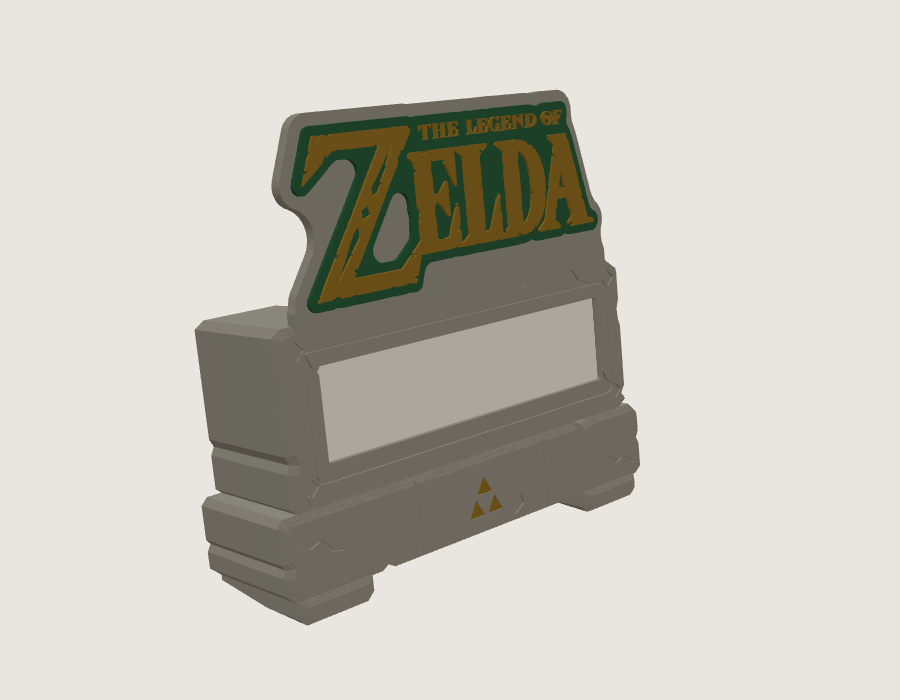
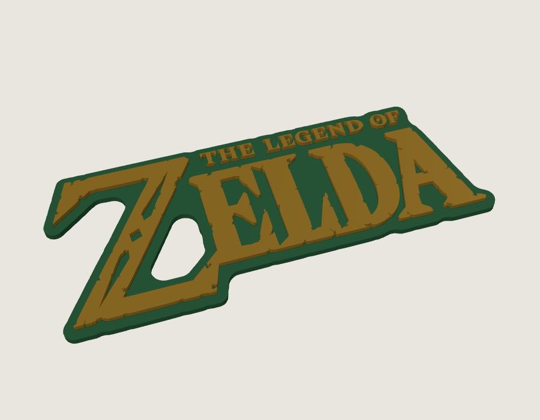
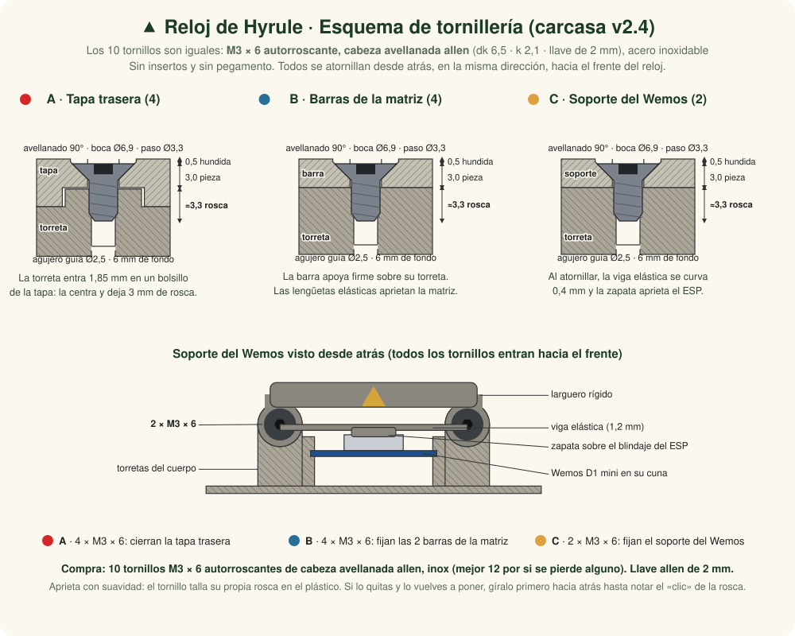
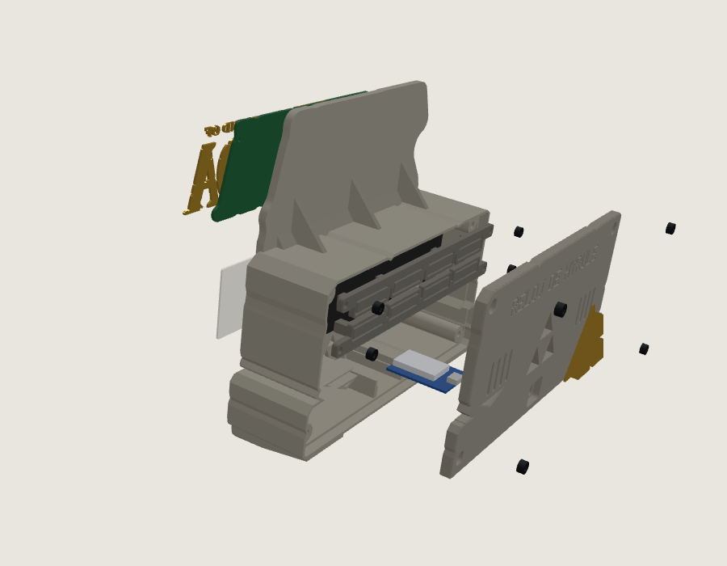
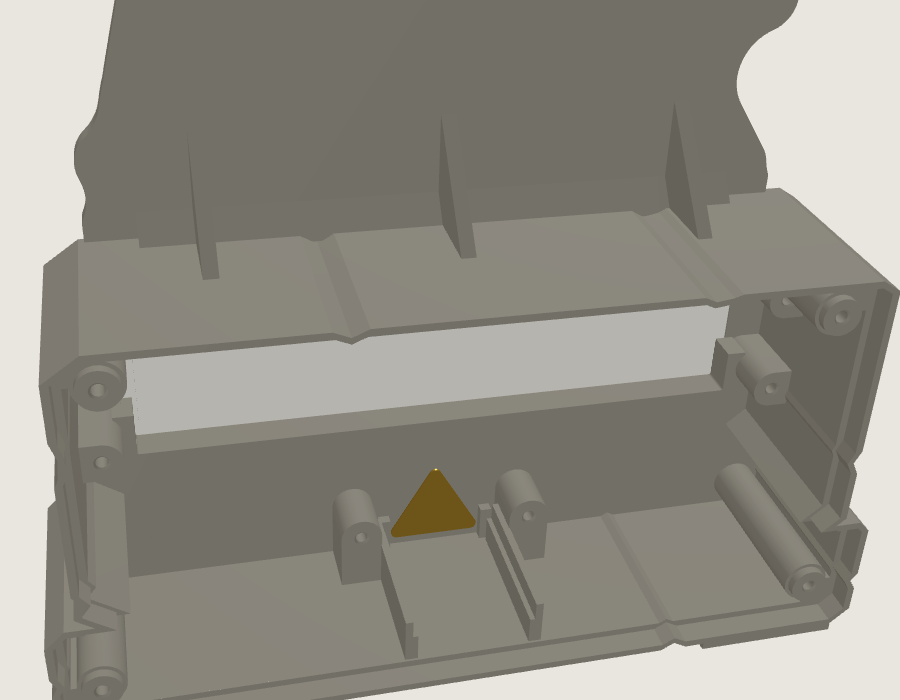
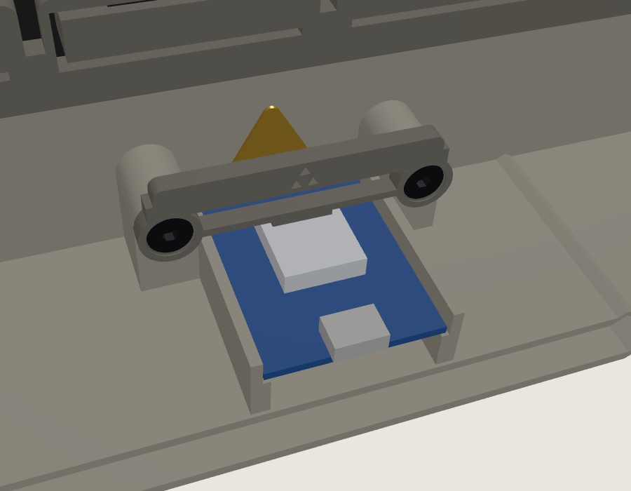
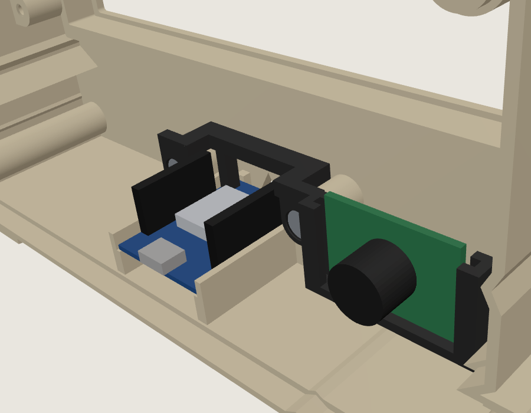
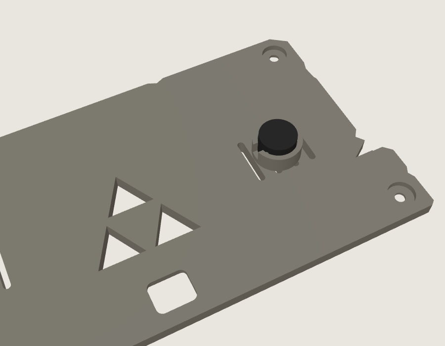

# Modelos 3D v2 · "Bloques de piedra antigua"

> ⚠️ Proyecto de fans **sin ánimo de lucro** y no oficial. *The Legend of Zelda* es una marca de Nintendo. Prohibida la venta de piezas o relojes. Ver [AVISO_LEGAL.md](../AVISO_LEGAL.md).



Carcasa **diseñada desde cero** como dos bloques de piedra antigua de Hyrule:

- **Losa superior:** la pantalla está en una ventana con una ranura tallada alrededor y rombos en las esquinas. Encima va la cresta con el logo.
- **Pedestal inferior:** más ancho, con juntas de piedra, una **Trifuerza dorada incrustada** y el **Wemos D1 mini dentro**, sujeto con un **soporte atornillado, sin pegamentos**.
- **Detalles de piedra:** esquinas desgastadas, grietas talladas y bordes achaflanados.
- **Dos patas de piedra:** inclinan el reloj **8° hacia atrás** para leerlo mejor desde la mesa.
- **Tapa trasera con 4 tornillos avellanados:** las cabezas quedan hundidas en la tapa. Lleva la Trifuerza dorada grande, el **puerto USB centrado justo debajo**, "RELOJ DE HYRULE" grabado con la fuente de píxeles del reloj y rejillas de ventilación.
- **La matriz LED, bien sujeta:** va en un marco que la centra y dos barras atornilladas la aprietan contra la ventana. Sirve para matrices 4 en 1 de **128 a 130 mm** de largo y de cualquier grosor.

**Medidas:** 168 mm de ancho, unos 157 mm de alto (con la cresta) y 46 mm de fondo. Peso aproximado: 185 g con la electrónica. Es muy estable: el centro de masas cae en mitad del apoyo.

---

## 1. Piezas

| # | Pieza | Archivo | Color recomendado | Cantidad |
|---|-------|---------|-------------------|----------|
| 1 | Carcasa (losa, pedestal, patas y cresta) | `cuerpo_piedra.stl` | **Gris piedra** (PLA gris, "piedra" o mármol) | 1 |
| 2 | Tapa trasera **sin zumbador** | `tapa_trasera.stl` | Gris piedra | 1 |
| 2 | **O bien:** tapa trasera **con zumbador** (aro por dentro, detrás de una rejilla) | `tapa_trasera_zumbador.stl` | Gris piedra | 1 |
| 3 | Ventana difusora | `ventana_difusora.stl` | **Blanco** (deja pasar la luz de los LED) | 1 |
| 4 | Trifuerza dorada de la tapa | `trifuerza_dorada_trasera.stl` | Dorado silk | 1 |
| 5 | Trifuerza dorada del pedestal | `trifuerza_dorada_frontal.stl` | Dorado silk | 1 |
| 6 | Barras de sujeción de la matriz | `barras_sujecion_matriz.stl` | Cualquiera (no se ven) | 1 (2 barras) |
| 7 | Soporte del Wemos | `soporte_wemos.stl` | Cualquiera (no se ve) | 1 |
| 7 | **O bien:** soporte para Wemos **con pines soldados** y aro para el zumbador | `soporte_wemos_zumbador.stl` | Cualquiera (no se ve) | 1 |
| 8 | Fondo del logo | `fondo_logo.stl` | Verde | 1 |
| 9 | Letras del logo | `logo_letras_geektoybox.stl` | Dorado silk | 1 (14 piezas) |
| 8 + 9 | **O bien:** logo en una sola pieza (opción B) | `logo_dos_colores.stl` | Verde y dorado, con una pausa | 1 |

### Dos formas de hacer el logo

| | Opción A: piezas sueltas | Opción B: una pieza con pausa |
|---|---|---|
| Archivos | `fondo_logo.stl` + `logo_letras_geektoybox.stl` | `logo_dos_colores.stl` |
| Cómo se hace | Fondo verde y 14 letras doradas por separado; las letras se pegan una a una | Se imprime de una vez: a 2,0 mm la impresora se para, cambias el verde por el dorado y sigue |
| Ventajas | Las letras se imprimen con capas muy finas (0,12 mm) y el dorado sale sin ningún resto de verde | Sin pegar letras, sin piezas pequeñas que se pierdan, letras más marcadas (sobresalen 1,5 mm) |
| Necesita | Pegamento y paciencia | Una impresora que pueda pausar (casi todas) |



Ya no hace falta que la carcasa sea de color claro: la luz sale por la ventana difusora blanca, así que la piedra puede ser gris u oscura.

### Autores y licencias

| Archivo | Autor | Licencia |
|---------|-------|----------|
| `cuerpo_piedra.stl`, `tapa_trasera.stl`, `tapa_trasera_zumbador.stl`, `ventana_difusora.stl`, `barras_sujecion_matriz.stl`, `soporte_wemos.stl`, `soporte_wemos_zumbador.stl`, Trifuerzas | **Diseño original** de este proyecto | CC BY-NC-SA 4.0 |
| `logo_letras_geektoybox.stl` | **geektoybox** ([Printables](https://www.printables.com/model/499505-legend-of-zelda-logo-text)), sin cambios | CC BY-NC 4.0 |
| `fondo_logo.stl`, `logo_dos_colores.stl` y la cresta | Hechos a partir del logo de geektoybox | CC BY-NC 4.0 |

Si compartes tu impresión (por ejemplo, un *make* en Printables), cita a geektoybox y este repositorio. **Prohibido el uso comercial.**

---

## 2. Tornillería y material extra

**Todos los tornillos del reloj son iguales:** **M3 × 6 autorroscante de cabeza avellanada allen** (cabeza Ø6,5 × 2,1 mm, hexágono de 2 mm), en acero inoxidable. **No hacen falta insertos:** cada tornillo talla su propia rosca en un agujero guía de Ø2,5 mm. **Todos se atornillan desde atrás, en la misma dirección**, hacia el frente del reloj. Tampoco hace falta pegamento para la electrónica.



| Qué | Cantidad | Para qué |
|-----|----------|----------|
| **Tornillo M3 × 6 autorroscante, cabeza avellanada allen**, inox | **10** (compra 12) | 4 cierran la tapa (A), 4 fijan las barras de la matriz (B) y 2 el soporte del Wemos (C) |
| Llave allen de **2 mm** | 1 | |
| Trozos de filamento de 1,75 mm de unos 3,5 mm | 2 | Guías para centrar el fondo del logo |
| Pegamento (cianoacrilato en gel) | — | Solo para el logo y las Trifuerzas |

**La misma cuenta para los 10 tornillos:** la cabeza queda **0,5 mm hundida** en un avellanado de 90°, el tornillo atraviesa **3 mm de pieza** y rosca **unos 3,3 mm** en la torreta. El agujero guía tiene 6 mm de fondo, así que la punta nunca toca el final.

- **Tapa (A):** la tapa mide 5 mm, pero cada torreta entra 1,85 mm en un bolsillo de su cara interior. Así la tapa queda centrada sola y el tornillo solo atraviesa 3 mm.
- **Barras (B):** la barra se atornilla firme sobre una torreta alta, siempre a la misma altura. La matriz la sujetan las **lengüetas elásticas** de la barra, que se doblan lo necesario y la empujan contra la ventana. Valen para matrices de **9 a 14,5 mm** de grueso, desde la cara de los LED hasta la parte de atrás de la placa: así sirven para todos los módulos habituales.
- **Soporte del Wemos (C):** es una pieza de 3 mm que se apoya en la cara trasera de dos torretas, a los lados de la cuna, y se atornilla **desde atrás, como la tapa**. Tiene un larguero rígido arriba y una **viga elástica** abajo, con una zapata en el centro. Al atornillar, la zapata baja sobre **el blindaje metálico del módulo ESP** (una zona plana, sin pines ni componentes), la viga se curva 0,4 mm y la placa queda apretada contra su cuna. El avellanado centra el soporte en su sitio, así que siempre aprieta igual.

**Aprieta con suavidad:** el tornillo forma la rosca en el plástico; si te pasas, la rompe. Si quitas un tornillo y lo vuelves a poner, gíralo primero hacia atrás hasta notar el "clic" de la rosca y luego apriétalo.

---

## 3. Ajustes de impresión

Material: PLA, 1,75 mm. Ninguna pieza necesita soportes.

| Pieza | Orientación | Capa | Relleno | Notas |
|-------|-------------|------|---------|-------|
| Carcasa | **Boca abajo**: el frente (con la cresta) sobre la cama, tal como viene el STL | 0,2 mm | 15 % | Cama de 170 × 160 mm como mínimo. **4 perímetros**, para que las torretas tengan pared maciza alrededor de los agujeros guía. Las grietas, la ranura de la ventana y los chaflanes salen en la primera capa: usa una cama lisa. |
| Tapa trasera | **Boca abajo**: la cara con el texto sobre la cama, tal como viene | 0,2 mm | 20 % | 5 mm de grosor. El texto y los avellanados quedan en la cara de la cama; los bolsillos de las torretas, arriba. |
| Ventana difusora | Plana | 0,2 mm | 100 % | 131 × 33 × 1 mm: deja pasar la luz difuminada. Para más contraste, prueba con 0,8 mm. |
| Barras de sujeción | Tal como vienen: cara de los avellanados sobre la cama y columnas hacia arriba | 0,2 mm | 100 % | Dos barras en el mismo archivo. Mejor en **PETG** (más elástico); en PLA también funcionan. |
| Soporte del Wemos | Plano, tal como viene: avellanados sobre la cama | 0,2 mm | 100 % | Mejor en **PETG**, por la viga elástica; en PLA también funciona. |
| Soporte para Wemos con pines (`soporte_wemos_zumbador.stl`) | Tal como viene: **boca abajo**, con la cara de arriba sobre la cama | 0,2 mm | 100 % | Sin soportes: todo baja recto desde la cama. El agujero del aro queda tumbado; si sale alguna rebaba arriba, límala. |
| Trifuerzas doradas | Con la pestaña plana sobre la cama y los triángulos hacia arriba | 0,12–0,16 mm | 100 % | La cara de arriba de los triángulos es la que se ve. |
| Fondo del logo | Plano, con el rebaje de las letras hacia arriba | 0,2 mm | 100 % | |
| Letras del logo | Planas, tal como vienen | 0,12–0,16 mm | 100 % | 14 piezas sueltas; usa un *brim* fino si alguna se despega. |
| Logo en una pieza (opción B) | Plano, tal como viene: agujeros guía abajo y letras arriba | **0,2 mm** (también 0,1 o 0,25) | 100 % | **Pausa / cambio de filamento a 2,0 mm.** Verde hasta 2,0 mm y dorado desde ahí hasta 3,5 mm. Ver la sección siguiente. |

### Logo en dos colores con pausa (opción B)

`logo_dos_colores.stl` mide 3,5 mm: los primeros **2,0 mm son el fondo** y los últimos 1,5 mm son **las letras**. Se imprime con un solo extrusor cambiando el filamento a mitad:

1. Carga el filamento **verde** y abre el archivo en el laminador, plano, tal como viene.
2. Usa una altura de capa que divida exacto los 2,0 mm: **0,2 mm** (con primera capa de 0,2), o 0,1 o 0,25. Con 0,12 o 0,16 el cambio no caería justo en el borde de las letras.
3. Añade el cambio de color **en la capa que empieza a 2,0 mm**, es decir, la primera capa que solo tiene letras (con capas de 0,2 mm es la capa que termina a **2,2 mm**):
   - **PrusaSlicer / OrcaSlicer / Bambu Studio:** en la vista previa por capas, sube el deslizador hasta **2,20** y pulsa el **+** que aparece junto a él (cambio de color, M600). En Bambu sin AMS, elige "Añadir pausa".
   - **Cura:** *Extensiones → Post-procesamiento → Modificar G-Code → Añadir script → Pause at height* (o *Filament Change*), con **altura de pausa 2,2 mm**.
4. Imprime. Cuando la impresora se pare, saca el verde, carga el **dorado**, purga hasta que salga dorado limpio, quita el hilo sobrante de la boquilla y continúa.
5. Si tu impresora no admite M600, usa la orden de pausa (M601 o la de tu firmware) y cambia el filamento a mano desde el menú.

El logo se monta igual que el de la opción A: con los 2 trozos de filamento en los agujeros de atrás y pegado a la cresta.

**Toque mágico opcional:** pasa un pincel seco con pintura gris clara o blanca sobre la piedra. Resaltará las grietas, las juntas y los bordes, y parecerá piedra de verdad.

---

## 4. Montaje



1. **Roscas:** pasa una vez cada tornillo por su agujero guía, sin piezas, y sácalo. Así el plástico queda roscado y el montaje es más fácil. Son 10 agujeros: 4 en las esquinas de atrás (tapa), 4 a los lados de la ventana (barras) y 2 junto a la cuna del Wemos (soporte).
2. **Trifuerzas:** mete la Trifuerza dorada pequeña por dentro del frente del pedestal y la grande por dentro de la tapa. La pestaña queda apoyada por dentro y los triángulos a ras por fuera. Fíjalas con unas gotas de pegamento. Hazlo antes de colocar el Wemos.
3. **Logo:** con la opción A, coloca las 14 letras en el rebaje del fondo verde y pégalas. Con la opción B, el logo ya sale entero de la impresora. En los dos casos, pon los 2 trozos de filamento en los agujeros de detrás, encájalos en los agujeros de la cresta y pega el logo.
4. **Ventana:** con la carcasa boca abajo (el frente sobre la mesa), deja caer la ventana difusora por el hueco del marco de la matriz. Tiene el mismo tamaño que la matriz y baja hasta el fondo, donde encaja en un rebaje de 1 mm alrededor de la ventana. No hace falta pegarla: la matriz la aprieta contra el frente.

   

5. **Matriz:** métela en su marco, encima de la ventana difusora, con los LED hacia la ventana y el conector de entrada hacia cualquiera de los dos lados. Los cortes laterales del marco dejan paso a los pines y los cables.
6. **Barras:** pon las dos barras por detrás de la matriz, con las columnas de las lengüetas hacia la placa, y atorníllalas **hasta el fondo** sobre sus torretas con 4 tornillos M3 × 6. Las lengüetas se doblan solas y dejan la matriz firme contra la ventana.
7. **Wemos D1 mini (sin pegamento):** suelda los 5 cables (ver el [esquema](../imagenes/esquema_conexiones.svg)). Apoya la placa en la cuna, con el módulo ESP (el rectángulo metálico) hacia arriba y el USB hacia atrás, y deslízala hasta los topes delanteros. Coloca el soporte por detrás de sus dos torretas, con la zapata sobre el ESP, y atorníllalo **desde atrás** con 2 tornillos M3 × 6. La placa queda sujeta por los cuatro lados: guías a los lados, topes delante, la tapa detrás y el soporte arriba.

   

8. **Cables:** conecta los cables a la **entrada (IN)** de la matriz. Hay sitio de sobra entre el pedestal y la matriz.
9. **Zumbador (opcional, en desarrollo):** hay dos sitios; elige uno.
   - **En la tapa (`tapa_trasera_zumbador.stl`):** mete el zumbador de 12 mm en el aro que hay por dentro de la tapa (entra suelto, **sin apretar**), con el agujero mirando a la rejilla, y saca los cables por la ranura del aro. Es el que más se oye.
   - **Junto al Wemos (`soporte_wemos_zumbador.stl`):** es el soporte para un Wemos con **tiras de pines y conectores dupont**. No pasa por encima de los pines: cruza solo por la punta de la antena y aprieta la placa con dos patas en sus esquinas libres. A un lado tiene un **aro para el zumbador de 12 mm**. Antes de atornillar el soporte, mete el zumbador en el aro **por delante** (el lado que mira al frente del reloj), con el agujero del zumbador hacia la tapa, hasta que quede a ras por detrás. El aro es **holgado a propósito**: los nervios solo lo rozan. **No lo aprietes ni lo fuerces**: si el cilindro queda estrujado, el disco de dentro se frena y casi no suena. Si baila, sujétalo con una gota de silicona caliente **en la base**, nunca tapando el agujero de arriba. Si el zumbador va soldado en una placa pequeña, la placa queda colgando de él, hacia delante; hay sitio para una de hasta 28 × 20 mm. Después atorníllalo desde atrás con 2 × M3 × 6.

   

   La conexión está en el [esquema del zumbador](../imagenes/esquema_zumbador.svg).

   

10. **Tapa:** colócala de forma que las torretas entren en sus bolsillos y ciérrala con 4 tornillos M3 × 6. El conector USB del Wemos queda justo detrás del hueco de la tapa, debajo de la Trifuerza.

Si las letras de la pantalla salen giradas o desordenadas, no hace falta abrir: en la página del reloj, ve a **Pantalla** y cambia el giro o el orden de los módulos.

---

## 5. Generar las piezas tú mismo (opcional)

[`generar_modelos.py`](generar_modelos.py) crea todas las piezas desde cero. Solo necesita el logo original de geektoybox:

```
pip install trimesh manifold3d shapely numpy
python3 generar_modelos.py --logo LoZ_Logo_Text.stl
```

Al principio del archivo están todas las medidas (fondo, tamaño de la ventana, posición del Wemos, tornillos, inclinación...) por si quieres adaptarlo a otra matriz, otra placa u otros tornillos.

---

## 6. Lista de comprobación

- [ ] 10 agujeros guía roscados una vez con el tornillo
- [ ] Trifuerzas doradas pegadas (frente y tapa)
- [ ] Logo listo (letras pegadas en el fondo, o impreso en dos colores) y pegado en la cresta
- [ ] Ventana difusora en su rebaje
- [ ] Matriz en su marco, LED hacia delante, sujeta con las 2 barras (4 × M3 × 6)
- [ ] Wemos en la cuna, USB hacia atrás, sujeto con el soporte (2 × M3 × 6), cables a la entrada (IN) de la matriz
- [ ] Tapa cerrada con 4 tornillos M3 × 6

¡Que la Trifuerza te acompañe! ▲

---
*Homenaje de fans sin ánimo de lucro. No oficial y sin relación con Nintendo.*
